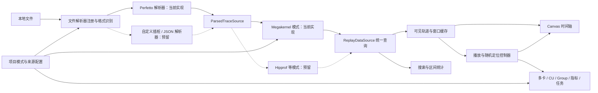

# VisualStream 推理重放设计

更新：2026-11-06。状态：首版 MVP 已实现，增加 Tauri 2 桌面入口。本文保留完整设计和后续阶段，当前可运行范围、验证方式与限制以根目录 README 为准。

## 1. 产品目标与边界

将已经采集的推理执行记录重放为可观察、可定位、可统计的时间过程。用户可以从任意时间开始播放，以统一播放头联动时间轴、资源视图、指标和事件详情。

同时提供网站与 Tauri 2 桌面形态，共用 Vue 3 + TypeScript 前端和 Perfetto WASM 解析流程。网站优先支持桌面 Chrome / Edge，Windows 客户端使用系统 WebView2。WASM、脚本等资源由产品一并提供。宿主文件能力通过 `WorkspaceHost` 适配；后续增加 VS Code 扩展适配、本地原生解析服务和远程采集。

首版覆盖：

1. 仅实现 Megakernel 计算模式 + Perfetto 源文件解析器，完成现有样例的导入和多卡 → CU → Group 映射。
2. 时间轴拖动、缩放、随机定位、播放、变速、事件步进和区间循环。
3. CU 矩阵、当前任务与时间轴联动。
4. 区间统计、搜索、书签、项目保存和多文件会话。
5. 定义独立的文件解析器和计算模式接口；其他文件解析器、Hipprof 等计算模式只保留扩展位置，不进入首版交付。

实时硬件采集、全量 warp 指令重放、模型数值仿真、自动根因判定和团队协作放在后续版本。离线重放展示采集时的数据；实时采集使用单独的运行模式。

## 2. 文件解析与计算模式

文件解析器负责读取源文件；计算模式负责解释计算组织和资源含义。两者独立注册、独立配置、独立版本管理，通过中间数据契约组合。

| 层次 | 负责 | 不承担的职责 |
| --- | --- | --- |
| 文件解析器 `TraceFileParser` | 识别编码与源格式，解码时间、原始轨道、事件、属性、计数器和来源引用 | 不将 `block` 自动解释为 CU，不决定计算资源层级 |
| 中间数据 `ParsedTraceSource` | 提供格式无关的原始记录与分批查询句柄，保留时钟、来源和扩展字段 | 不要求所有来源具有 CU、Group 或 warp |
| 计算模式 `ComputeModelPlugin` | 根据记录解释设备、资源层级、任务归属、关联与可提供的视图 | 不读取 Perfetto Protobuf，不直接访问 Perfetto SQL 表 |
| 重放数据 `ReplayDataSource` | 向播放和视图提供统一的资源、事件、状态、指标、关联与能力查询 | 不暴露底层文件类型或数据库实现 |

同一 Megakernel 模式未来可以读取 Perfetto、手动插桩产生的自定义文件或其他源格式；同一 Perfetto 解析器也可以服务其他计算模式。Hipprof 作为用户规划的另一个计算模式，未来可以接入 JSON、Perfetto 或自定义解析器；这些组合当前不实现。

| 计算模式 | 文件解析器 | 本次状态 |
| --- | --- | --- |
| Megakernel | Perfetto | 唯一实现和验收的组合 |
| Megakernel | 自定义插桩文件等 | 预留接口 |
| Hipprof | Perfetto | 预留接口 |
| Hipprof | JSON / 自定义文件 | 预留接口 |

JSON、`.prof` 等扩展名不能单独确定源数据协议。相同 JSON 编码中的字段结构可能不同，后续应按实际数据协议注册解析器，而不是让一个 JSON 解析器猜测所有业务结构。

### Megakernel v1

用户已确认计算层级为多卡 → CU → Group，当前每个 CU 只有一个 Group。资源树定为：

```text
会话
└─ 计算卡 Device[]
   └─ CU[]
      └─ Group[]，当前为 group_0
         └─ 活动任务、事件与原始轨道
```

- `block_<编号>` 到 CU 的映射属于 Megakernel 模式，不属于 Perfetto 解析器。
- 原始记录通过轨道父链及模式规则归属 Device、CU、Group，保留原始轨道层级及名称。
- Group 是正式资源实体，以集合表达；当前每个 CU 对应 `group_0`，不能在类型和视图中省略这一层，也不把 Group 等同于 warp。
- Group 身份由设备、CU 和 Group 编号共同限定。不同 CU 下的 `group_0` 是不同资源；同一 CU 中属于同一个 Group 的多条原始轨道可以映射到同一个 Group，但原始轨道和事件分别保留。
- rank 是进程或分片的元数据，与 Device 分开表达，不假定一个 rank 必然等于一张卡。
- `TASK_LINEAR_*`、`TASK_SCHD_EVENTS_*` 保留任务原名。不能仅根据名称认定具体框架算子、独立 GPU kernel 或硬件调度状态。
- 相同名称的多个任务实例分别保留；不以任务名去重或强制合并。
- 有额外任务映射时再补充算子、模型层和阶段，并允许多对多关联。

CU 矩阵按 Group 聚合展示。点击 CU 可以查看当前 `group_0` 和原始任务轨道，未来增加 Group 数量时沿用相同资源树。一个 CU / Group 可以具有多个被记录的活动任务，详情展示活动集合。

## 3. 样例检查与基线

对 `trace_demo` 中三个文件进行了 Protobuf 字段级结构检查，并配对 begin/end。首版实现进一步使用官方 Trace Processor WASM 交叉核对，TP1 的 128,200 个区间和 TP2 各 222,664 个区间均已通过浏览器验收。下表轨道数统计文件中的原始 TrackDescriptor，与引擎重组后的规范化轨道数不同。

| 文件简称 | 大小，十进制 MB | 轨道数 | 配对区间事件数 | 事件时间跨度 |
| --- | ---: | ---: | ---: | ---: |
| tp1 / gpu1 | 5.83 | 700 | 128,200 | 约 171.27 ms |
| tp2 / rank0 / gpu1 | 10.14 | 760 | 222,664 | 约 119.38 ms |
| tp2 / rank1 / gpu2 | 10.14 | 760 | 222,664 | 约 119.38 ms |

共同特征：

- 每份文件包含 `block_0` 至 `block_75` 共 76 个顶层资源。按用户确认的 Megakernel 规则，首版显示 76 个已记录 CU；这不等于已验证设备物理 CU 总数。
- 存在大量 `group_0` 命名的下级轨道；原始轨道按 ID 保留，再由 Megakernel 模式映射到所属 CU 的 Group。不能仅根据同名跨 CU 合并 Group，也不能因此丢弃原始轨道。
- 样例事件包含 `TASK_LINEAR_*`、`TASK_SCHD_EVENTS_*` 等名称。
- 检查到的 TrackEvent 字段包含类别、事件类型、名称引用和轨道引用；没有发现 debug annotation、flow 或 counter 事件，轨道描述中也未发现 counter 类型。
- begin/end 配对检查没有发现未闭合或多余结束事件。
- 不同文件存在重复 track UUID，导入后必须以 source ID 隔离。
- 文件名包含 rank、gpu、step 等提示；提示和记录内部的正式元数据分别标注。

这些样例可以验证 CU 任务重放、轨道活动率、搜索和区间统计。实测硬件利用率、拷贝字节数、通信关系、模型层和 token 等需要补充采集数据。

样例只有约 0.12–0.17 秒，播放速度必须支持大幅慢放。

## 4. 导入与解析选项

导入流程：选择计算模式 → 识别 / 指定源文件解析器 → 解码源记录 → 校验模式兼容性 → 构建资源与任务解释 → 显示预览 → 建立会话。

首版一个会话采用一个计算模式，每个源文件独立记录解析器。这样以后同一 Megakernel 会话可以接入不同格式的文件。混合多个计算模式的会话不在本次范围。

默认展示以下选项：

| 选项 | 首版行为 |
| --- | --- |
| 计算模式 | 会话级，首版只有 Megakernel |
| 源文件解析器 | 文件级，首版只有 Perfetto；自动识别仅在已注册解析器中进行 |
| 会话 | 新建或加入已有会话 |
| 设备 / rank | 优先读取正式元数据；文件名提示允许确认或修改 |
| 时钟对齐 | 使用记录信息、选定共同标记、相对起点或手动偏移 |

Megakernel 高级选项：

- CU 提取规则默认匹配顶层 `block_<非负整数>`；CU 编号来自名称中的整数。
- 任务根据原始轨道父链映射到所属 CU 和 Group。
- Group 编号按模式规则提取，当前每个 CU 对应 `group_0`；保留多 Group 的数据结构。
- 可选加载任务到算子映射文件；没有映射时展示原始任务。

预览展示计算模式、源解析器、设备、76 个已记录 CU、各 CU 的 Group、原始轨道数量、时间跨度、可用指标和诊断。格式识别不能代替计算模式选择；即使文件可被 Perfetto 解码，也必须校验它是否满足 Megakernel 所需的结构。

源解析器及其选项放在文件属性，计算模式及其选项放在会话属性。未来修改解析器需要重新解码该来源；修改计算模式只重建计算解释，资源预算允许时复用源解析结果。重建时保留有效时间标记，重新校验资源和关联。

首版界面只展示 Megakernel 与 Perfetto 这一个可用组合。通用模式、Hipprof、JSON 和自定义源解析器均不作为已支持功能显示。

## 5. 界面布局

```text
┌──────────────────────────────────────────────────────────────────┐
│ 项目 / 导入 / 保存      当前会话      布局 / 视图 / 设置             │
├────────────┬─────────────────────────────────────────────────────┤
│ 文件与会话 │ 上方多视图：CU 矩阵 | 指标曲线 | 当前活动任务          │
│ 模式与来源 │ 可并排、切换、调整分隔线                             │
│ 设备与轨道 │                                                     │
│ 当前重放   ├─────────────────────────────────────────────────────┤
│ 数据能力   │ 播放 / 时间输入 / 速度 / 步进 / 循环 / 跟随            │
│            ├─────────────────────────────────────────────────────┤
│            │ 全局概览条与可视窗口                               │
│            │ 时间标尺、播放头、分层轨道与事件块                    │
├────────────┴─────────────────────────────────────────────────────┤
│ 可收起详情：事件详情 | 区间统计 | 搜索结果 | 导入诊断                │
└──────────────────────────────────────────────────────────────────┘
```

默认左侧约 260 px，上方工作区占主区域约 55% 高度，时间轴约 45%；面板支持调整大小、折叠及恢复默认布局。提供分析布局和放大 CU 视图的演示布局，二者共用相同播放时间。

左侧包含文件管理、导入状态、会话计算模式、文件源解析器、设备、轨道搜索与显示控制、当前位置、总跨度、播放状态、元数据与数据能力。

启动时保持空白，不提供内置记录。当前会话与历史文件可独立折叠；成功导入的文件按 SHA-256 指纹存储在本机 IndexedDB，历史文件可重新加入会话，移出会话不删除历史。当前会话用复选框多选，默认勾选新导入的文件，清空选择时主视图与时间轴为空；任务、搜索、概览及利用率仅查询勾选的来源。项目保存显示选择并兼容旧项目；恢复时优先从本机历史找回原始文件，缺失时再由用户导入。

### CU / 资源矩阵

- Megakernel 模式显示设备下的 CU，并可展开当前 Group；视图从资源树读取层级，不依据文件扩展名选择布局。
- 单元格显示 CU 名称、当前任务和状态。并发时显示任务数量，展开查看活动集合。
- 点击 CU 定位轨道；选中时间轴事件时反向高亮 CU 和任务。
- 默认网格布局；有真实拓扑数据时才提供物理拓扑布局。
- 区分记录活动、未知和数据缺口。只有采集覆盖充分时才能将没有活动解释为空闲。

### 指标与当前活动

- 指标视图展示已采集的 counter，保留单位、采样窗口、来源及缺口。
- 缺失指标显示未采集，不能用 0 补齐。
- 当前活动展示原始任务、kernel、拷贝和通信事件；有可靠关联时增加算子、模型层、prefill / decode、step 和 token。
- 一个算子可以关联多个 kernel 或 Megakernel 任务，一个融合任务也可能关联多个算子。
- 嵌套、时序相邻和真实依赖分别处理，不能相互替代。

## 6. 时间轴与播放

时间轴默认按设备 → CU → Group → 原始轨道分层，可按来源、rank 和事件类别筛选，并保留查看原始结构的能力。计算、拷贝和通信分类只有在来源明确或规则可追溯时才应用。

| 操作 | 行为 |
| --- | --- |
| 点击标尺 / 拖动播放头 | 跳转并更新所有关联视图 |
| 滚轮 | 纵向滚动轨道 |
| Shift + 滚轮 | 横向平移 |
| Ctrl / Meta + 滚轮 | 在时间轴内以指针位置为中心缩放 |
| 中键，或按住空格拖动 | 平移可视时间窗口 |
| 轨道区域框选 | 创建区间并显示统计 |
| 点击事件 / 双击事件 | 选中并显示详情 / 缩放到事件附近 |
| F / Z | 适配整条记录 / 缩放到选区或事件 |
| Space | 播放 / 暂停；输入或拖动时不触发 |
| I / O | 设置循环入点 / 出点 |
| 左 / 右方向键 | 当前筛选范围内的前一 / 后一事件边界 |

提供全局概览、轨道固定、搜索、书签、范围高亮和可选吸附。借鉴剪辑软件的时间导航和播放操作；首版的交互不修改事件位置或持续时间。

全局分别维护播放位置、可视窗口、选中事件和选中区间，不能将它们合并成一个状态。

- 支持任意位置正向播放、暂停、精确时间输入、区间循环和双向事件步进。
- 速度预设 0.00001×、0.00005×、0.0001×、0.0005×、0.001×、0.01×、0.1×、0.5×、1×，默认 0.0001×，支持自定义正数。
- 提供将完整记录在 20 秒内播完的演示模式，按真实时长换算速度，默认不启用；启用时禁用速度滑动条，关闭后恢复之前的档位。
- 调速时以当前位置重新建立时间锚点，保持连续。
- 拖动播放头时暂停推进，释放后恢复原播放状态。
- 默认跟随播放头，可关闭后自由浏览其他时间。
- 切到浏览器后台后暂停；缺少窗口数据时缓冲并冻结播放时间。
- 连续倒放在后续版本考虑，首版向前 / 向后定位都能直接查询。

播放位置根据单调墙钟和锚点计算，不能按固定帧数或事件数量推进：

```text
trace 时间 = trace 锚点 + (当前单调墙钟 - 墙钟锚点) × 速度
```

资源活动区间采用 `[start, end)`。屏幕两帧之间的极短事件可能不逐个可见；通过慢放、缩放、步进和密度摘要观察，摘要不能改变真实时间。

## 7. 数据模型与格式

| 输入 | 当前状态与扩展策略 |
| --- | --- |
| Perfetto Protobuf，常见 `.perfetto-trace` / `.pftrace` | 首版实现 Perfetto 解析器，组合 Megakernel 模式 |
| 手动插桩生成的自定义文件 | 后续增加对应协议解析器，复用已有计算模式 |
| Chrome Trace / 特定 JSON 协议 | 后续独立注册格式解析器，按能力组合计算模式 |
| gzip 等压缩容器 | 后续可增加解压前处理，与计算模式无关 |
| `.prof` | 后续确认实际协议后增加源解析器 |
| 只有汇总统计的数据 | 后续可提供统计查看，不生成虚构时间重放 |

`.prof` 扩展名不足以定义解析协议。至少需要事件时间、持续时间及轨道 / 资源信息，才能重放。

核心实体：

| 实体 | 内容 |
| --- | --- |
| Session / TraceSource | 会话的计算模式与版本；各来源的文件指纹、解析器、版本和选项 |
| ParsedTraceSource | 解析器输出的格式无关原始轨道、事件、属性和分批查询接口 |
| ReplayDataSource | 计算模式输出的统一资源树、状态、事件、指标与关联查询接口 |
| ClockTransform | 时钟域、单位、偏移、漂移、对齐依据与误差 |
| Device / Resource | 通用资源树；Megakernel 使用 Device → CU → Group，记录逻辑 / 物理标识与映射来源 |
| Track | 原始轨道、父级、布局、资源归属 |
| SpanEvent | 来源引用、开始、结束、任务名、类别、属性、完整性 |
| CounterSeries | 时间、数值、单位、采样语义与覆盖范围 |
| Correlation | 多对多关联、关系类型与证据 |
| Marker / Phase | 书签、阶段、step、token 及来源 |
| Coverage / Capability | 缺口、采集范围、支持粒度、指标及关联能力 |

内部采用 int64 纳秒，TypeScript 使用 BigInt 或等价保精度编码。绘图时先减去局部时间原点，再转为 Number。项目 JSON 用字符串保存 int64。

ID 带 source ID 命名空间。相同 CU 编号或 track UUID 在不同文件中不能冲突；同名任务也不是同一实例。持久定位使用文件指纹和稳定来源引用，不单独依赖解析器行号。

一个会话可以包含多个 rank 文件。优先读取同步信息，其次提供共同标记或手动偏移。无同步证据时可做相对起点对齐，但标记为对齐未验证。不能仅用同名事件或近似开始时间证明精确同步。

首版保留独立来源及统一查询门面，不直接拼接 Protobuf 字节。真实跨设备通信关系必须具有端点、关联和对齐依据。

## 8. 分析口径

所有数据区分采集记录、由记录计算和规则推断。

| 指标 | 定义 |
| --- | --- |
| CU 已记录任务活动率 | CU 下活动任务区间并集长度 ÷ 统计窗口；注明覆盖范围 |
| 计算区间占比 | 已明确分类的计算区间并集 ÷ 窗口 |
| SM / CU Active、occupancy 等 | 只展示相应采集数据，保留硬件定义与采样窗口 |
| 拷贝吞吐 | 有字节数与可靠时间范围时计算，并说明口径 |
| 通信占比 | 已明确分类的通信区间并集 ÷ 窗口 |
| 计算通信重叠率 | 计算与通信区间并集的交集长度 ÷ 窗口 |
| 累计事件耗时 | 各事件持续时间之和；并发时可以大于端到端耗时 |
| 端到端耗时 | 选区长度或有依据的阶段首尾时间差 |

框选统计将跨越边界的事件裁剪到选区内。缺少覆盖时返回未知。仅当明确没有活动时返回 0。

CU 已记录任务活动率不能直接称为算力利用率或 occupancy。通信任务也可能使用计算资源，因此计算、拷贝和通信不能强制组成总和为 100% 的饼图。

## 9. 技术选型

| 层次 | 首版选择 | 用途 |
| --- | --- | --- |
| 形态 | Web，桌面 Chrome / Edge 首发 | 验证交互，浏览器本地解析 |
| 前端 | Vue 3 + TypeScript 7 + Vite | Composition API、单文件组件、工作台和构建 |
| 类型检查 | TS7 原生检查；Vue SFC 使用 vue-tsc + typescript-native-bridge | 保留模板类型检查并接入 TS7 原生检查引擎，初始化时锁定兼容版本 |
| UI | Tailwind CSS + shadcn-vue | 控件、主题、菜单和弹层 |
| 布局 | Vue 面板组件与可调分隔线 | 固定布局及可调分隔线，后续再加自由停靠 |
| 状态 | Pinia | 项目、筛选、面板和选择状态 |
| 时间轴 | 自研 Canvas 2D 渲染器 | 缩放、播放头、命中和 LOD |
| 指标曲线 | ECharts | 普通 counter 曲线，不承担主时间轴 |
| 源文件解析 | 独立 Perfetto 解析器，内部使用 Trace Processor WASM | 解码源记录，封装内部 SQL 与原始数据查询 |
| 计算解释 | 独立 Megakernel 模式插件 | 将原始记录映射为多卡 → CU → Group 和任务 |
| 后台处理 | Web Worker | 文件读取、解析、索引、查询与聚合 |
| 数据传输 | 批量查询、TypedArray、transferable ArrayBuffer | 控制主线程负载和复制成本 |
| 项目与设置 | IndexedDB + `.vstream.json` | 布局、书签、模式、文件引用与对齐 |
| 桌面入口 | Tauri 2 + 系统 WebView | 复用现有前端，Rust 管理本地文件与后续辅助进程 |
| 大文件扩展 | Perfetto 解析器可切换原生 Trace Processor 后端 | 不将原生 Trace Processor 变成其他解析器的必需依赖 |
| 转换与采集 | 按需增加 Python / FastAPI 适配服务 | 厂商格式和采集端集成，不作为首版必需后台 |
| 验证 | Vitest + Playwright | 时间语义、查询一致性、视图联动与性能回归 |

Vue 负责工作台，高频播放和绘制由独立 TypeScript 控制器管理。Pinia 保存 UI 状态和轻量查询结果；大规模事件、索引和渲染器实例留在引擎中，不做全量深度响应式。使用 `shallowRef` / `markRaw` 等边界接入外部引擎，避免每帧驱动完整组件树更新，也不要为每个事件建立 DOM。

### TypeScript 7 与 Vue 工具链

用户已确定 Vue 3 + TypeScript 7。TypeScript 7 的主要收益是编译、类型检查和开发工具性能，不把它计入浏览器绘图帧率的提升。

Microsoft 在 2026-07-08 发布 TypeScript 7.0，公开大型项目完整编译基准约有 8–12 倍提速；这不是本项目的实测结果。Vite 的转译 / 打包与静态类型检查分开运行，因此不能将该倍数直接套用到 Vite 热更新或端到端构建时间。

Vue 的 `.vue` 单文件组件需要模板到虚拟 TypeScript 的处理。Vue Language Tools 维护者在 2026-07-23 确认采用 `typescript-native-bridge` 作为 TS7 原生检查接入方向；其公开 vue-tsc 基准为 12.8 秒到 4.7 秒，说明 Vue 全流程不会自动获得纯 TS 编译相同的倍数。

首版按以下方式接入：

- 核心模块与 Worker 使用独立 `.ts` 文件，类型检查采用 TS7 原生引擎。
- Vue 组件采用 `<script setup lang="ts">` 与 Composition API，使用 vue-tsc 保留模板、props 和事件的检查。
- Vue 工具侧使用 `typescript-native-bridge` 兼容经典 Compiler API，并由其内部调用 TS7 原生检查器；明确区分这个独立桥接项目与 Microsoft 官方 TypeScript 包。
- 实际初始化工程时锁定 TypeScript、Vue Language Tools 和桥接依赖的完整兼容版本，通过本机验证后再写入锁文件；此设计阶段尚未安装或验证依赖。
- 验证普通 TS 错误、Vue 模板错误、props / emits 类型、Worker 模块边界和生产构建，不能只验证 Vite 能启动。

数据处理放入 Worker；Canvas 首版在主线程按可见区域绘制，保留渲染器接口。只有压测确认必要时引入 OffscreenCanvas / WebGL2。首版不依赖 WebGPU。

Perfetto Trace Processor 只是 Perfetto 源解析器的内部实现。WASM、RPC 协议及封装采用同一固定上游版本，隔离在解析器模块并遵守上游许可。自定义解析器可以采用自己的二进制解码、索引或存储后端，不需要先转换为 Perfetto。计算模式、播放控制器及视图不能依赖 Trace Processor 或其表结构。

工作台与时间轴由产品实现，不能假设完整 Perfetto UI 是可以直接引入的通用时间轴组件。

完整 Perfetto UI 的 iframe 接口可以作为后续高级查看入口。本产品的统一播放时间、CU 状态和事件联动由自己的控制器管理。

桌面版确定使用 Tauri 2，共用现有前端。浏览器输入 / 下载与桌面系统文件对话框通过独立宿主接口适配。以后 VS Code 扩展注入自己的宿主文件接口，并另行实现 Webview 资源地址、消息和 CSP 适配；不会要求复制一套重放业务。当前桌面版保留 WASM 解析，原生大文件后端后续单独接入。

## 10. 模块与性能



职责划分为：

```text
trace-core                  中间记录、资源树、查询及能力契约
trace-import                解析器注册、识别、导入编排和兼容性校验
trace-parsers/perfetto       当前唯一源解析器，封装 Trace Processor
compute-models/megakernel    当前唯一计算模式，多卡 → CU → Group
replay-engine               全局时钟、随机定位和播放状态
timeline                    时间轴、轨道虚拟化与命中
views                       资源、任务、指标和详情
project                     配置、来源、映射、对齐和保存
```

第一轮可以在单个前端工程内使用这些目录，不要求独立 npm 包。只有 Perfetto 解析器模块可以引入 Trace Processor 实现。

### 扩展契约

| 契约 | 最小职责 |
| --- | --- |
| `ParserRegistry` | 按解析器 ID 注册实现，运行内容探测并选择已安装解析器 |
| `TraceFileParser.probe` | 检查源内容与协议版本，返回格式识别依据；不猜测计算模式 |
| `TraceFileParser.open` | 返回 `ParsedTraceSource`，支持分批读取、原始窗口查询、取消及释放 |
| `ParsedTraceSource` | 原始元数据、轨道父链、事件、属性、时钟、可选 counter / 关联，以及能力和诊断 |
| `ComputeModelRegistry` | 独立按计算模式 ID 注册实现 |
| `ComputeModelPlugin.validate` | 根据原始能力和实际结构检查是否可解释，报告必要字段缺失与可选能力不足 |
| `ComputeModelPlugin.build` | 接收一组源查询句柄与模式配置，生成资源解释和 `ReplayDataSource` |
| `ReplayDataSource` | 统一查询元数据、资源树、轨道、窗口事件、时刻活动、指标、统计、搜索和关联 |

解析器和模式兼容性取决于中间记录是否包含所需结构，不按扩展名或笛卡尔积默认兼容。比如 Perfetto 能解码的文件不一定具有 Megakernel 的 block / group 结构；缺少必要结构时应停止构建并提供诊断，缺少可选算子映射时可以降级展示原始任务。

中间层是格式无关的数据契约，不是强制全量物化的事件数组。原始数据及索引可以留在解析器后端，计算模式保留资源映射和必要索引，通过查询句柄按需访问，避免导入时复制几份全量数据。原始字段及来源引用需要保留，以便后续模式使用和详情溯源。

普通视图读取通用资源树；Megakernel 专属视图通过模式 ID 及能力选择，不检查文件类型。以后增加源解析器不修改计算模式与播放 UI，增加计算模式也不修改已有源解析器；接口契约满足时可以直接组合。

性能原则：

- 轨道虚拟化、横向裁剪，只请求可视范围并预取邻近窗口。
- 远处展示密度，中间尺度合并窄事件，近处展示原始事件和文字。
- LOD 只影响绘制，不改变详情和统计使用的原始数据。
- 全量数据主要留在解析引擎，不复制到 Pinia，也不包装成深层响应式事件集合。
- 使用列式批次与字符串字典，设置缓存上限。
- 播放使用缓存窗口和边界索引推进，不每帧执行 SQL。
- 随机 seek 直接查询活动状态，不从零遍历，包含窗口之前开始的长事件。
- 查询带版本号，丢弃过期缩放、拖动和筛选结果。
- 视图可以降低刷新频率，但不能单独推进播放时间。
- 导入及长查询可取消，并报告进度与诊断；关闭会话释放引擎和缓存。

首轮性能目标必须在固定机器、浏览器和视口条件下实测：现有样例拖动与播放争取 60 fps，缓存命中交互 p95 小于 50 ms，未命中随机定位目标小于 200 ms。使用 100 万和 1000 万事件合成数据继续测量容量、内存峰值和 LOD 正确性；这些是验证目标，不代表已经达到。

## 11. 项目保存与诊断

`.vstream.json` 分别保存会话计算模式及版本 / 选项，以及每个来源的解析器及版本 / 选项；另保存文件指纹、可选句柄、设备映射、时钟对齐、布局、筛选、书签、循环区间和最后位置。默认不内嵌原始 trace。

配置示意：

```json
{
  "computeModel": { "id": "megakernel", "version": "1", "options": {} },
  "sources": [
    {
      "fileRef": "rank0-trace",
      "parser": { "id": "perfetto", "version": "1", "options": {} },
      "deviceRef": "card-0",
      "rank": 0
    }
  ]
}
```

浏览器可能要求重新选择文件；重新关联时校验指纹。设置保存在 IndexedDB，大文件缓存为可选能力，并提供占用和清理入口。

未知格式、时间单位异常、CU 规则匹配失败、无 CU 归属任务、事件未闭合、采集缺口、关联缺失、对齐未验证和内存不足，都给出可定位诊断。未知信息不以虚构状态补齐。

## 12. 迭代与验收

### M0：Perfetto 解析器与 Megakernel 模式验证

- 验证 Vue 3 + TypeScript 7 的 Vite、vue-tsc 和原生桥接版本组合，确认普通 TS 与 Vue 模板的类型诊断均有效。
- 固定 WASM 版本与构件获取 / 构建方式。
- 用三个样例验证轨道、时钟、区间数与随机窗口查询。
- Perfetto 解析器只输出原始记录，不包含 block → CU 规则。
- Megakernel 模式通过 `ParsedTraceSource` 正确识别多卡、每份样例的 76 个 CU 和各 CU 下的 `group_0`，再关联任务。
- 计算解释不改变原始事件时间，不依赖 Perfetto SQL 或内部表。
- 不同 CU 的同名 Group 分别识别；同一 Group 的多条原始轨道和事件完整保留；跨文件相同 UUID 不串数据。
- 使用少量内存源记录夹具验证 Megakernel 模式的格式独立性；夹具是接口验证，不是另一个已发布文件解析器。

### M1：单文件重放闭环

- 完成工作台、会话计算模式与文件源解析器配置、时间轴和多卡 / CU / Group 视图。
- 完成拖动、缩放、随机播放、慢放、步进、循环与跟随。
- 验收任意 seek 与正常播放在同一时刻得到相同活动状态；调速和暂停恢复不跳时。

### M2：分析和项目

- 完成统计、搜索、详情、书签、项目保存和恢复。
- 按 Megakernel + Perfetto 组合的实际能力展示 counter、算子关联和 flow；当前样例缺少的数据标记未采集。
- 验收并发按并集统计，边界裁剪正确，未采集指标不显示为 0，缺少映射时保留任务原名。

### M3：多文件和容量

- 完成 TP2 双 rank 会话、来源隔离、对齐配置和状态标识。
- 本阶段仍只验收 Megakernel + Perfetto，不加入 Hipprof、JSON、自定义文件或通用模式实现。
- 测量大文件性能与内存，决定原生引擎接入时点。

## 13. 后续适配需要的信息

已经确定 Megakernel 的多卡 → CU → Group 结构、`block = CU` 和当前每个 CU 只有一个 Group，可直接开始 Megakernel + Perfetto 的重放实现。以下信息用于后续扩大能力，不计入当前交付：

1. `.prof` 的生成工具、结构、时间单位和字段定义。
2. Group 的进一步调度语义，以及任务到框架算子、模型层的映射。
3. 首个深度支持的设备平台、counter 来源和跨 rank 同步依据。

## 14. 技术依据

- [TypeScript 7.0 发布与编译性能](https://devblogs.microsoft.com/typescript/announcing-typescript-7-0-native/)
- [Vue Language Tools 的 TS7 支持与原生桥接进展](https://github.com/vuejs/language-tools/issues/5381)
- [typescript-native-bridge 的兼容范围与接入方式](https://github.com/johnsoncodehk/typescript-native-bridge)
- [Vue 与 TypeScript 工具链](https://vuejs.org/guide/typescript/overview)
- [Vite TypeScript 转译与类型检查边界](https://vite.dev/guide/features.html)
- [Pinia 状态管理](https://pinia.vuejs.org/introduction.html)
- [shadcn-vue](https://www.shadcn-vue.com/docs/introduction)
- [Perfetto Trace Processor 与 SQL](https://perfetto.dev/docs/analysis/trace-processor)
- [Perfetto 大文件与原生解析](https://perfetto.dev/docs/visualization/large-traces)
- [Perfetto iframe API](https://perfetto.dev/docs/visualization/embedding-api-reference)
- [Perfetto UI 插件](https://perfetto.dev/docs/contributing/ui-plugins)
- [PyTorch Profiler 与 Chrome Trace 导出](https://docs.pytorch.org/docs/stable/profiler.html)
- [NVIDIA Nsight Systems 硬件指标](https://docs.nvidia.com/nsight-systems/UserGuide/index.html)
- [AMD ROCprofiler thread trace](https://rocm.docs.amd.com/projects/rocprofiler-sdk/en/latest/how-to/using-thread-trace.html)
- [Tauri 2 架构](https://v2.tauri.app/concept/architecture/)
- [Tauri 各平台 WebView](https://v2.tauri.app/reference/webview-versions/)
